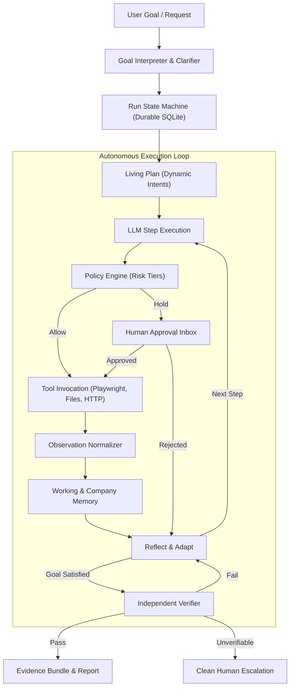

# CentrAlign AI: Autonomous Task Worker & Enterprise Operator

> **CentrAlign AI** is a production-grade autonomous agent engine that translates human goals into verifiable real-world actions across browsers, internal ERPs, APIs, and file systems. Built with an explainable hand-written loop, independent ground-truth verification, living memory, and strict policy guardrails, it ships with two release configurations from a single core: the **Autonomous Task Worker** (`intern-v1`) and the **Enterprise AI Operator** (`founding-v1`).

---

## 1. Fast Start

### Prerequisites
- Python 3.11+
- Make & Git

### Setup & Run
```bash
# 1. Clone repository
git clone <repo-url> centralign
cd centralign

# 2. Automated environment setup (virtualenv, dependencies, playwright chromium)
make setup

# 3. Run test suite
make test

# 4. Start mock company apps (ERP, Vendor Portal, Mailbox, Tickets)
make run-env

# 5. Run end-to-end demo
make demo
```

---

## 2. Architecture & The Autonomous Loop

CentrAlign AI operates on an 8-stage state machine that avoids brittle hardcoded heuristics:

```
Goal ──► Understand ──► Plan ──► [ Select Tool ──► Policy Check ──► Execute ──► Observe ──► Reflect/Adapt ] × N ──► Verify ──► Report
```



---

## 3. Submissions & Mode Comparison

| Feature Layer | Task Worker (`intern-v1`) | Enterprise Operator (`founding-v1`) |
|---|---|---|
| **Autonomous Core Loop** | Hand-written explainable state machine | Same core engine |
| **Tool Execution** | Real Playwright browser, file parsing, HTTP | Real Playwright browser, file parsing, HTTP |
| **Verification** | Independent ground-truth state verifier | Independent ground-truth state verifier |
| **Company Memory** | Working memory in-run | FTS5 persistent memory + procedure SOPs |
| **Policy Engine** | Basic confirmation prompts | Config-driven risk tiers & approval queue |
| **Durable Jobs** | In-process execution | SQLite durable job queue & crash-resume |
| **Feedback Loop** | Single-run adaptation | Persistent learned lessons across tasks |
| **Generalization** | Core invoice workflow | Unseen tasks (Tickets, HR onboarding, CSV recon) |

---

## 4. Key Architectural Decisions (ADR Summary)

- **Hand-written Loop over Heavy Frameworks:** Eliminates black-box magic (LangChain/CrewAI). Every state transition, thought, tool invocation, and reflection is directly traceable, explainable, and testable.
- **Accessibility / DOM Tree First:** Uses Playwright a11y snapshots for semantic element locators and token economy, with visual screenshots reserved for human evidence and VLM fallback.
- **Independent Verifier:** The agent's own summary is never trusted. Real database rows, file hashes, and HTTP responses are validated against source extraction before declaring completion.
- **Company Memory as Data:** No `if task == 'invoice'` in code. The LLM derives operational procedures from `company/` markdown and YAML files.
- **Durable SQLite Architecture:** Zero infrastructure bloat. Runs, audit logs, background jobs, and memory vectors/FTS run reliably in embedded SQLite with WAL mode.

---

## 5. Technology Stack & Dependencies

- **Language & Runtime:** Python 3.11+, Pydantic v2
- **Browser Automation:** Playwright (Chromium)
- **Mock Apps:** FastAPI, SQLite, Jinja2 / HTML templates
- **LLM Clients:** Provider-agnostic client (Gemini 2.5 Flash default, OpenAI, Claude, plus offline `FakeLLM`)
- **Testing & Quality:** Pytest, Pytest-Asyncio, Ruff

---

## 6. Evaluations & Fault Matrix

CentrAlign AI evaluates against an automated test matrix with deliberate fault injection:

| Fault Scenario | System Response & Recovery | Verifier Check |
|---|---|---|
| **Slow Page / Network Delay** | Exponential backoff, settle detection | Pass |
| **Button / Selector Renamed** | Semantic re-snapshot & fuzzy locator | Pass |
| **Mid-task Session Expiry** | Auto re-login via vault & resume step | Pass |
| **Invoice Missing from Portal** | Source fallback (Portal → Mailbox → Files) | Pass |
| **Ambiguous Vendor Name** | Clarification pause to human | Pass |
| **Duplicate Bill Submission** | Rejection detection & report without write | Pass |
| **Threshold Exceeded (> ₹50k)** | Policy hold in Approvals Inbox | Pass |
| **Prompt Injection in Document** | Ingested as passive data; policy blocks | Blocked & Reported |

---

## 7. Known Limitations & Next Steps

### Limitations
- Primary browser automation assumes accessibility tree availability (standard web apps); non-DOM canvas apps rely on screenshot coordinate fallback.
- OCR for heavily blurred or degraded physical document scans relies on clean pre-processing.

### What We'd Build Next
- Distributed worker pooling across multiple worker nodes using Postgres.
- Bidirectional live voice interaction for human-in-the-loop approvals.
- Self-healing connector generation from OpenAPI / Swagger specs.

---

## 8. Live Walkthrough & Explainability Guide

See [`docs/WALKTHROUGH.md`](file:///Users/abdulahadmomin/.gemini/antigravity/scratch/centralign/docs/WALKTHROUGH.md) for live discussion preparation, code tour, and practice exercises.
